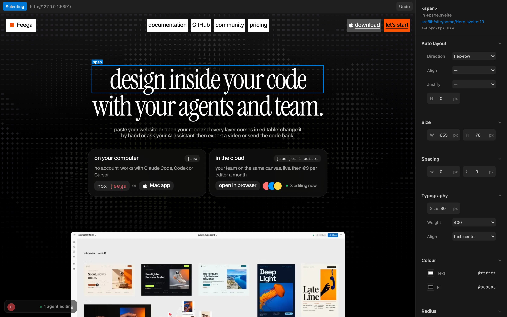
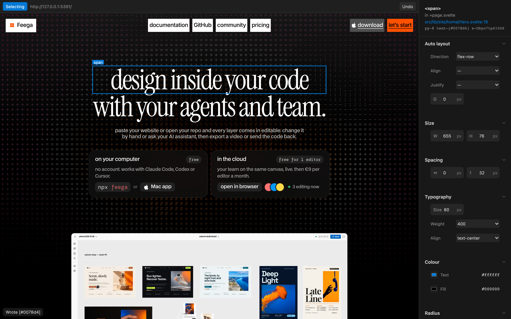

# Feega

Design in your codebase. Click any element of your running app, edit it from a design panel, and the change is written to your code. No AI, no tokens.

[](https://marketplace.visualstudio.com/items?itemName=andreabuttarelli.feega)
[](https://marketplace.visualstudio.com/items?itemName=andreabuttarelli.feega)
[](https://open-vsx.org/extension/AndreaButtarelli/feega)
[](https://www.npmjs.com/package/feega)
[](LICENSE)
[](https://buy.stripe.com/5kQ00k2A97C08sd94LeME07)

[Watch the demo](https://feega.app/video/feega-demo.mp4)





## Install

- **VS Code**: [Marketplace](https://marketplace.visualstudio.com/items?itemName=andreabuttarelli.feega)
- **Cursor, Windsurf, VSCodium**: [Open VSX](https://open-vsx.org/extension/AndreaButtarelli/feega)
- **Any browser**: `npx feega` runs the same editor standalone

## How it works

- Run your app, open Feega, click any element.
- Edit size, spacing, colour, type and layout from the design panel.
- Feega finds the source of the element and writes the change as Tailwind classes or real CSS.
- Every change is a diff you can review and undo. Responsive sizes are supported.

## Supported

- Frameworks: React, Next.js, SvelteKit, Vue
- Styling: Tailwind, plain CSS

## Privacy

Everything runs locally. No account, and Feega sends nothing about your code or your app.

## Develop

```bash
# VS Code extension
cd inspect
npm run build
npm run test:e2e
npm run package

# npx feega
cd npx
node --test
```

Shared code lives in `packages/live-edit`, `packages/source-map` and `packages/properties-panel`. The site is in `landing/`.

## Contributing

Issues and pull requests are welcome, see [CONTRIBUTING.md](CONTRIBUTING.md). Feega Cloud (GitHub sync, collaboration, sections and templates) is coming later.

## License

[Apache-2.0](LICENSE)

## Support

Star the repo on [GitHub](https://github.com/andreabuttarelli/feega). Or [buy me a coffee](https://buy.stripe.com/5kQ00k2A97C08sd94LeME07).
