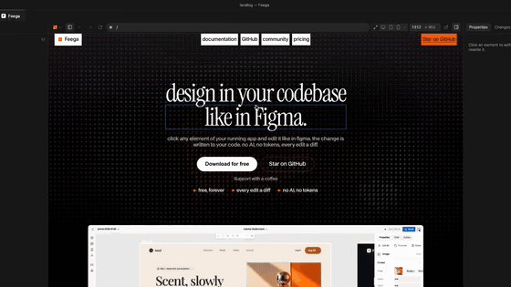
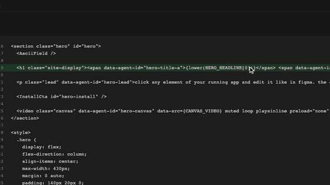

<p align="center"></p>

<h1 align="center">Feega</h1>

<p align="center"><b>A free, open-source visual editor for your codebase.</b><br>Click any element of your running app, edit it like in Figma, and the change is written to your code. No AI, no tokens, every edit a diff.</p>

<p align="center">
<a href="https://marketplace.visualstudio.com/items?itemName=andreabuttarelli.feega"></a>
<a href="https://marketplace.visualstudio.com/items?itemName=andreabuttarelli.feega"></a>
<a href="https://open-vsx.org/extension/AndreaButtarelli/feega"></a>
<a href="https://www.npmjs.com/package/feega"></a>
<a href="LICENSE"></a>

</p>

<p align="center"><a href="https://feega.app/video/feega-demo.mp4"></a><br><sub><a href="https://feega.app/video/feega-demo.mp4">Watch the full-quality video</a></sub></p>

## What it is

Feega is a VS Code extension, also available for Cursor, Windsurf and VSCodium, plus a standalone `npx feega` for any browser. It opens your running app, lets you select any element and edit size, spacing, colour, type and layout from a design panel. Feega finds the source of the element and writes the change as Tailwind classes or real CSS.

It runs on macOS, Windows and Linux. Everything is local: no account, and nothing about your code or your app leaves your machine.

| Select | Edit | Review |
|---|---|---|
|  |  |  |

## Install

<p>
 VS Code &nbsp;  Cursor &nbsp;  Windsurf &nbsp;  VSCodium &nbsp;  npx feega
</p>

- **VS Code**: [Marketplace](https://marketplace.visualstudio.com/items?itemName=andreabuttarelli.feega)
- **Cursor, Windsurf, VSCodium**: [Open VSX](https://open-vsx.org/extension/AndreaButtarelli/feega)
- **Any browser**: `npx feega`

## How it works

1. Run your app, open Feega and click any element.
2. Edit it from the design panel, including responsive sizes.
3. Feega writes the change to your source. Every edit is a diff you can review and undo.

## Frameworks

<p>
 SvelteKit &nbsp;  React &nbsp;  Next.js &nbsp;  Vue &nbsp;  Tailwind
</p>

SvelteKit, React, Next.js and Vue, with Tailwind or plain CSS (CSS modules, scoped `<style>`).

## Works with your agent

Feega has no AI of its own, so it sits next to the agent you already use: you design, your agent codes, same files, every change a diff.

Teach your agent Feega ([docs](https://docs.feega.app/more/ai-agents/)):

```bash
npx skills add andreabuttarelli/feega
```

In Claude Code:

```
/plugin install feega --marketplace andreabuttarelli/feega
```

<p>
 ChatGPT &nbsp;  Claude &nbsp;  Gemini &nbsp;  OpenCode
</p>

## Develop

The editor lives in `inspect/` (VS Code extension) and `npx/` (standalone), sharing one host core, on the [`feat/feega-inspect`](https://github.com/andreabuttarelli/feega/tree/feat/feega-inspect) branch until it lands on `main`.

```bash
cd inspect && npm install && npm test
cd npx && node --test
```

The site is in `landing/`.

## Contributing

Issues and pull requests are welcome, see [CONTRIBUTING.md](CONTRIBUTING.md). Feega Cloud (GitHub sync, collaboration, sections and templates) is coming later.

## License

[Apache-2.0](LICENSE)

## Support

[Star the repo](https://github.com/andreabuttarelli/feega), or [support Feega with a coffee](https://buy.stripe.com/5kQ00k2A97C08sd94LeME07).
