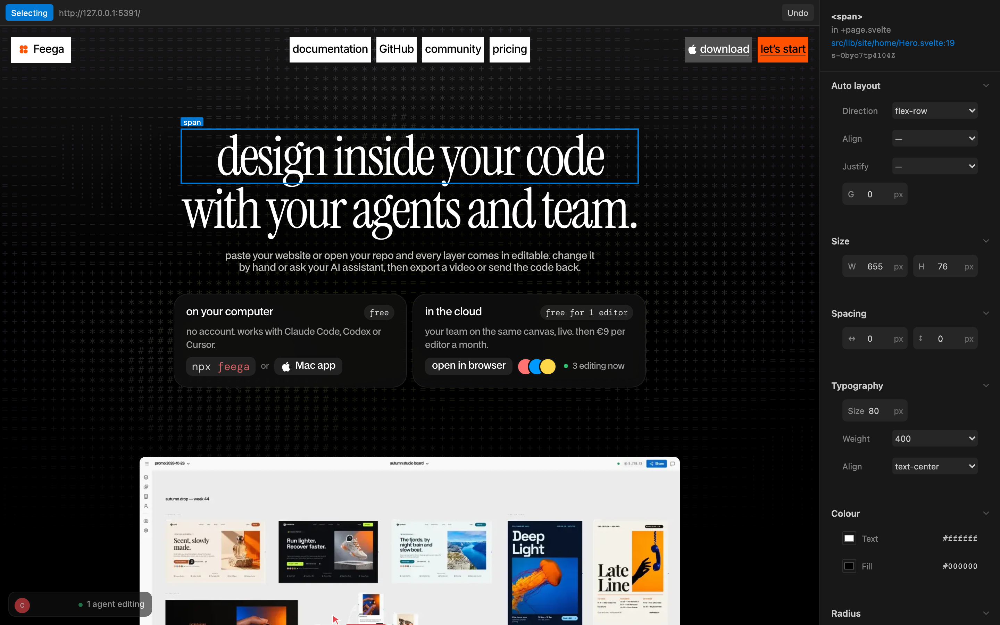
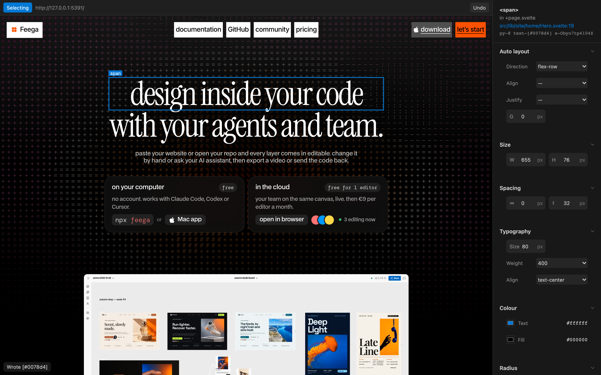
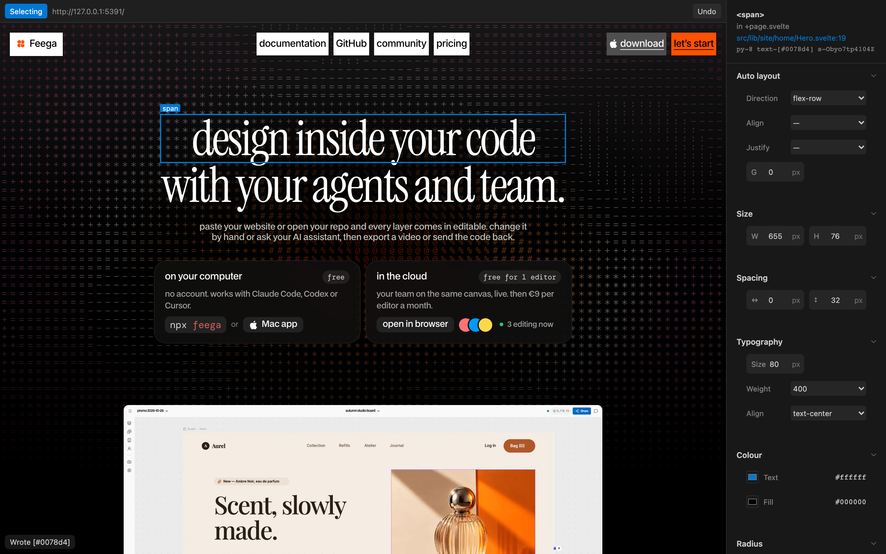
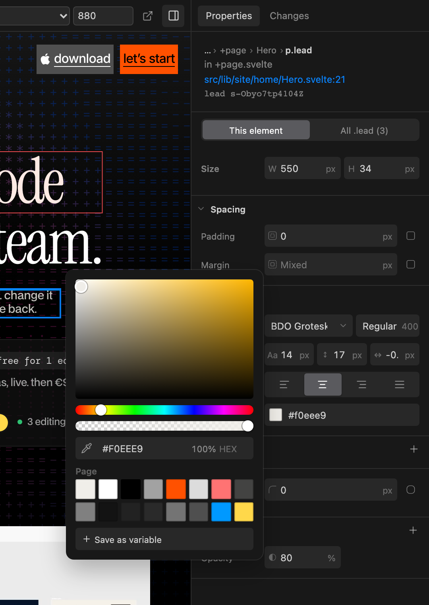

# Feega

Design in your codebase. Click any element of your running app, edit it like in Figma, and the change is written to your code. No AI, no tokens.

## How it works

1. Run **Feega: Open the running app** (or right-click a folder or page: **Design this folder with Feega**). Feega starts your dev server and opens the app beside your code.
2. Click an element. Edit text, spacing, size, colour, radius, typography in the right bar.
3. The edit lands in the source file: a Tailwind class (or your own token) when the project uses Tailwind, CSS otherwise.

## Features

- Click to select, breadcrumb to walk parents and siblings
- Text edited in place
- Box, layout, typography and colour controls with a colour picker
- Phone, tablet, desktop and full sizes
- Navigate mode to use the app, design mode to edit it
- Works in VS Code, Cursor and Windsurf

## Supported frameworks

React, Next.js, Svelte, SvelteKit, Vue, Astro and plain HTML, with Tailwind or CSS.

## Privacy

Feega sends nothing. No account needed. Your code never leaves your machine.

## Settings

Under `feegaInspect.*`: how styles are written (auto / Tailwind / CSS), dev server command, default device size.

## Links

- [Docs](https://docs.feega.app/integrations/inspect/)
- [Star on GitHub](https://github.com/andreabuttarelli/feega)
- [Support with a coffee](https://buy.stripe.com/5kQ00k2A97C08sd94LeME07)
