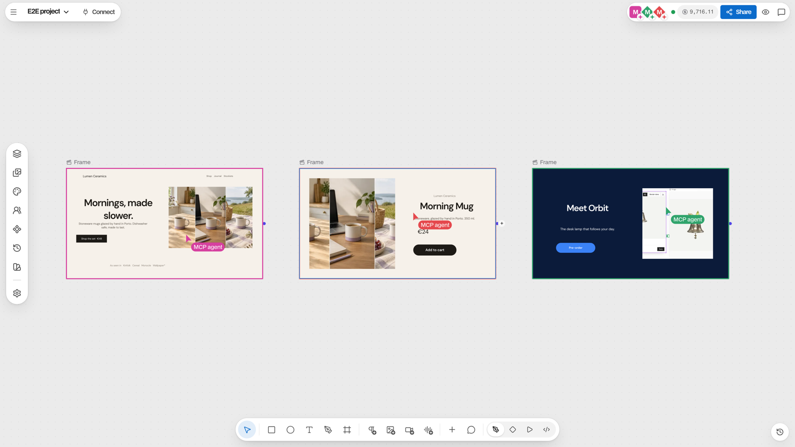

# Feega for Cursor and VS Code

Open `.feega` canvases in an editor tab: motion video, UI and graphic design on one infinite canvas, saved to a file in your repo. Your editor's agent connects to the open canvas over MCP and edits it live.

- **Feega: Open this folder as a project** opens the workspace folder. The canvas is saved in `.feega/`, committed with your repo.
- **Open a `.feega` file** to see it as a canvas.
- **Feega: Import this folder into a canvas** runs your project's dev server and draws its pages (up to 20) as editable frames.
- In a git repo the top bar shows the branch, commits the canvas, pushes to `origin` and opens a pull request on GitHub.

## Dev mode

Set `feega.devServerPath` to a clone of the Feega repo to run its `scripts/local.mjs` instead of `npx feega@latest`, for example to try the `dev` branch before a release. Run `npm ci && npm run build:node` in the clone first, and again after each pull.

Needs Node 22+. No account: the canvas runs on your machine (`npx feega`). Import the file at [feega.app](https://feega.app) to work in the cloud with your team.

Docs: [docs.feega.app/integrations/editor](https://docs.feega.app/integrations/editor/)
